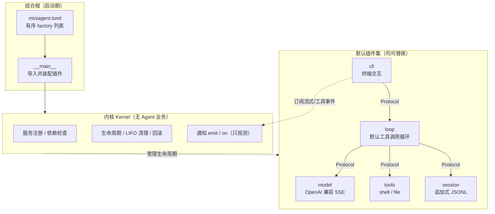
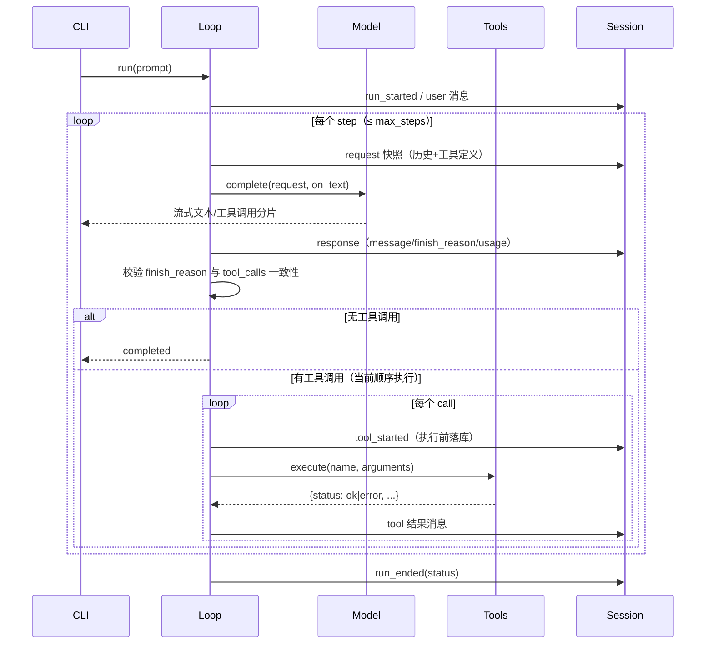
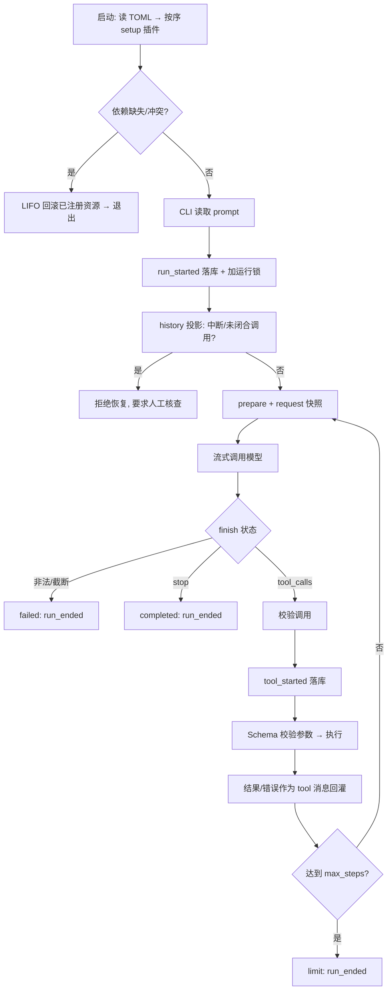

# miniAgent 架构设计与说明

> 状态约定：本文严格区分 **已实现（v0.1）** 与 **设计提案（未实现）**。
> 当前仓库已实现内核、模型适配器、工具循环、会话轨迹与 CLI；
> 「长期记忆」「自进化」尚不存在代码，仅给出与本架构一致的插件化设计。

---

## 1. 一句话定位

miniAgent 是一个**微内核 + 可替换插件**的 Agent 运行时，核心公式是：

```
Agent = Model + Harness
```

- **Model（模型）**：唯一的认知决策者，决定下一步说什么、调什么工具、何时结束。
- **Harness（线束/支架）**：模型之外的一切工程。它给模型提供能力（工具、上下文、执行环境），而**不替模型做认知决策**。

miniAgent 的 Harness 被压缩到最小：一个只负责装配与生命周期的**内核（Kernel）**，加上一组通过协议协作的**插件（Plugins）**。连默认的 Agent Loop 本身也是一个普通插件，可以被整体替换。

### 设计命题

> 随着模型变强，工程的价值重心会从「替模型思考」迁移到「为模型提供可靠的行动能力与可观测性」。

因此本架构刻意区分两类工程：

| 类别 | 例子 | 随模型变强的走向 |
|---|---|---|
| **认知代偿型工程**（应可删除） | 固定规划器、硬编码任务分类/路由、强制反思次数、预设多 Agent 分工 | 模型越强越应被关掉，且关掉后系统仍可运行 |
| **能力基础设施型工程**（必须保留） | 工具执行、上下文装配、会话持久化、取消/超时、权限边界、轨迹记录 | 不随模型变强而消失，只替换实现、增强可靠性 |

判断一个模块是否「越界」的标准：**删掉它，Agent 是否还能跑？** 认知策略插件应当是可摘除的；执行基础设施插件摘除后系统会失去对应能力，但不影响其它部分。

---

## 2. 设计原则

1. **内核无业务**：内核不导入任何具体插件，不知道模型、工具、循环的存在。新增工具/模型不改内核。
2. **一切能力皆插件，默认插件无特权**：模型、工具、会话、循环、界面都是插件；自定义循环与默认循环使用同一套接口。
3. **面向协议编程**：消费方依赖 `Protocol`（`Model` / `Tools` / `Session` / `AgentLoop`），不依赖具体厂商 SDK。
4. **模型可见即已记录**：每次真正发出去的请求都被快照进会话日志，模型看到了什么必须可重建、可审计。
5. **观测不能干预执行**：事件用于观察（`emit/on`），监听器异常被隔离，不能否决业务流程；业务动作只走显式服务调用。
6. **歧义时失败闭合（fail-closed）**：流没有结束原因、结束原因与工具调用矛盾、崩溃后存在结果未知的工具调用、系统提示变更——一律明确报错，绝不伪装成正常完成或自动重放。
7. **启动时组合**：v0.1 只支持启动期按配置装配，不做运行时热插拔，避免在最小版本引入额外的并发与一致性复杂度。

---

## 3. 「先进性」体现在哪（以及边界）

这里不做夸大宣传，只陈述与常见 Agent 脚手架的实质差异，并标注当前落地程度。

| 设计点 | 与传统脚手架的区别 | v0.1 状态 |
|---|---|---|
| **Loop 也是插件** | 多数框架把「思考-行动」循环硬编码在核心里；本架构的循环可整体替换（如换成代码执行式循环、批处理循环） | 已实现：`LoopPlugin` 仅依赖三个服务 |
| **能力接缝（Capability Seam）** | 换模型供应商/换工具后端，只需换一个提供者，不动调用方 | 已实现：`Model`/`Tools` 协议 |
| **请求级轨迹快照** | 常见实现只存聊天消息；这里额外存「适配后真正发出的 JSON 请求」，可逐字节重建模型输入 | 已实现：`request` 事件 |
| **副作用未知不自动重放** | 崩溃/取消发生在工具执行窗口内时，恢复会被**拒绝**，强制人工核查外部影响 | 已实现：未闭合工具调用检测 |
| **认知最小化** | 不内置规划器、路由、反思、多 Agent；把决策权完整留给模型 | 已实现：默认循环无策略层 |
| **可逆的插件生命周期** | 装配失败时按 LIFO 回滚已注册服务/监听/资源 | 已实现：`defer` + 启动回滚 |
| **配置即组合** | 通过 `miniagent.toml` 的 `factory` 列表决定装配，不改源码即可替换实现 | 已实现：TOML + `module:Class` 导入 |

**明确不具备 / 刻意不做（v0.1）**：

- 没有执行沙箱：`shell` 以宿主机当前用户权限运行（见 [安全边界](#11-安全边界)）。
- 没有工具并发执行：同一步中的多个工具调用按顺序执行。
- 没有上下文压缩/摘要：上下文超限时直接失败，而非悄悄做有损压缩。
- 没有长期记忆、向量检索、自进化、多 Agent、Web UI。
- 插件默认是受信任的同进程代码：插件化提供**解耦**，不提供**安全隔离**。

---

## 4. 总体架构

### 4.1 分层



实线是业务服务调用，虚线是内核对插件的管理与事件订阅。**内核不在每次推理的业务调用链上**：模型请求在 `loop → model` 间直接发生，内核不中转。

### 4.2 模块文件清单

| 文件 | 职责 |
|---|---|
| `src/miniagent/kernel.py` | `Plugin` 协议、`Context`（服务/清理/事件）、`Kernel`（有序启动、依赖检查、回滚） |
| `src/miniagent/contracts.py` | 共享数据类型与服务协议：`Message`、`ModelReply`、`Model`、`Tools`、`Session`、`AgentLoop`、`RunResult` |
| `src/miniagent/__main__.py` | 组合根：读取 TOML、按名导入工厂、启动内核、运行 CLI、关闭 |
| `src/miniagent/plugins/model.py` | OpenAI 兼容 Chat Completions（SSE 流式）适配器 |
| `src/miniagent/plugins/tools.py` | 工具注册表、JSON Schema 校验、`shell` 与 `file` 本地工具 |
| `src/miniagent/plugins/session.py` | 追加式 JSONL 会话、单写者锁、历史重建与恢复门禁 |
| `src/miniagent/plugins/loop.py` | 默认模型↔工具循环（普通插件） |
| `src/miniagent/plugins/cli.py` | 终端输入输出、流式打印、Ctrl+C 取消 |
| `miniagent.toml` | 默认装配与选项 |

---

## 5. 内核（Kernel）

内核只有三件事，全部位于 `kernel.py`。

### 5.1 服务注册与依赖检查

- 插件在 `setup(ctx)` 中通过 `ctx.provide(name, service)` 发布服务，通过 `ctx.require(name)` 取得依赖。
- 插件用 `requires = ("model", ...)` 声明依赖；内核按配置顺序启动，并在该插件 `setup` 前检查所需服务**已存在**，缺失即报错。
- 服务名重复注册、插件名重复都直接拒绝。

这意味着插件顺序是依赖顺序：`model / tools / session → loop → cli`。

### 5.2 生命周期与回滚

- 每个插件持有自己的 `Context`，`ctx.defer(fn)` 注册清理动作（支持同步/异步）。
- 任一插件 `setup` 失败，内核按注册逆序（LIFO）执行全部已注册清理，回收服务表项、移除监听器、关闭 httpx 客户端/文件句柄/子进程。
- 关闭阶段若多个清理失败，聚合成 `ExceptionGroup` 抛出，不吞错。

### 5.3 只观测、不裁决的通知

```python
ctx.emit("text", delta)          # 内核/插件发布
ctx.on("tool_started", handler)  # CLI 等订阅
```

- 监听器抛异常只被记录日志，**不会影响主流程**（避免「一个 UI 渲染 bug 杀死一次模型运行」）。
- 通知**不能**用于拦截/否决工具；需要改变执行结果，必须通过服务接口。这条边界防止业务逻辑被隐藏在难以追踪的事件回调里。

---

## 6. 协议层（Contracts）

`contracts.py` 是内核与插件、插件与插件之间的共享词汇表：

```python
class Model(Protocol):
    def prepare(self, messages, tools) -> dict: ...
    async def complete(self, request, on_text) -> ModelReply: ...

class Tools(Protocol):
    def definitions(self) -> list[dict]: ...
    async def execute(self, name: str, arguments: str) -> dict: ...

class Session(Protocol):
    def append(self, kind: str, data: dict) -> None: ...
    def history(self) -> list[Message]: ...

class AgentLoop(Protocol):
    async def run(self, prompt: str) -> RunResult: ...
```

关键决定：

- **消息体保留厂商原生字段**（`Message = dict[str, Any]`），不把所有模型强行压成纯文本，避免丢掉 `reasoning_content` 等能力字段。
- `prepare()` 是唯一的「适配接缝」：历史消息在发出去之前，由模型适配器决定如何映射/过滤。v0.1 的 OpenAI 适配器基本透传，未来兼容其它协议时在此收口。
- `RunResult.status` 只有四种确定状态：`completed / limit / failed / cancelled`，不允许把异常或截断包装成「成功」。

---

## 7. 默认插件

### 7.1 组合根：配置即装配（`__main__.py` + `miniagent.toml`）

```toml
[[plugins]]
factory = "miniagent.plugins.model:OpenAIModelPlugin"

[[plugins]]
factory = "miniagent.plugins.tools:ToolsPlugin"
[plugins.options]
cwd = "."
timeout = 30
output_limit = 20000

[[plugins]]
factory = "miniagent.plugins.session:SessionPlugin"
[plugins.options]
path = ".miniagent/session.jsonl"

[[plugins]]
factory = "miniagent.plugins.loop:LoopPlugin"
[plugins.options]
max_steps = 20

[[plugins]]
factory = "miniagent.plugins.cli:CLIPlugin"
```

`"module:Class"` 被动态导入，`options` 作为构造参数。要换模型，只需把第一行指向另一个工厂；内核与循环零改动。

### 7.2 模型插件（`model.py`）

- 走 OpenAI 兼容 Chat Completions，`stream=True`，逐行解析 SSE。
- `prepare()` 是纯函数：组装 `model / messages / stream / tools`。
- 流式增量按 `index` 重组并行的工具调用分片，文本增量实时回调 `on_text`。
- 深度合并 delta 时**保留扩展字段**（如 `reasoning_content`），而不是只保留可见文本。
- 失败语义明确：
  - HTTP 非 2xx：`raise_for_status()` 直接抛错，**不做隐式重试**（重试是上层/插件的显式决策，避免对有副作用请求造成 ABA 式重复）。
  - chunk 内带 `error` 字段：抛错。
  - 流结束却没有 `finish_reason`：抛错，不把截断当完成。

### 7.3 工具插件（`tools.py`）

见 [第 10 节：工具调用全链路](#10-工具调用已实现)。

### 7.4 会话插件（`session.py`）

见 [第 8 节：上下文](#8-上下文已实现)。

### 7.5 CLI 插件（`cli.py`）

- 只依赖 `AgentLoop` 协议，不直接拼模型请求、不直接执行工具。
- 订阅 `text`（流式打印）、`tool_started`（stderr 提示）、`response_end`。
- 一次性模式与交互模式共用同一条运行路径；交互输入用事件循环的 `add_reader` 监听 stdin，避免「在提示符处按 Ctrl+C 仍残留阻塞输入线程」。
- 退出码：成功 `0`，运行失败 `1`，取消 `130`。

---

## 8. 上下文（已实现）

### 8.1 上下文是会话历史的「投影」，不是另一套可变状态

每一步开始，循环都调用 `session.history()` 得到一份**从追加日志投影出来的不可变消息列表**：

```
[system] + [user / assistant(含 tool_calls) / tool 结果]...
```

然后：

```python
request = model.prepare(deepcopy(messages), tools.definitions())
request = json.loads(json.dumps(request, allow_nan=False))  # 序列化门禁
session.append("request", request)                          # 真实请求快照
reply = await model.complete(request, on_text=...)
```

要点：

- **每步重发完整历史 + 当前工具定义**，无隐式裁剪、无隐式摘要。
- **先快照、后发送**：落库的是「适配器产出后、真正发送的 JSON」，而非循环里的中间对象。`allow_nan=False` 顺带拦截 NaN/Infinity 等非法 JSON。
- 系统提示只来自会话头部，且**整个会话期内不可变**；系统提示变更会被拒绝，要求使用新会话文件，防止模型在不知不觉中「穿越制度」。
- 厂商扩展字段（如推理内容）被原样保存并在后续历史中透传；是否在回传时过滤，统一由 `Model.prepare()` 决定。

### 8.2 追加式轨迹（append-only Trajectory）

会话是单个 JSONL 文件，每条事件含 `seq / time / kind / data`，写入即 `flush + fsync`。事件类型：

| 事件 | 含义 |
|---|---|
| `session` | 头部：格式版本 + 固定系统提示 |
| `message` | 模型可见消息：system/user/assistant/tool |
| `request` | 每步真正发出的请求体快照 |
| `response` | 模型消息、finish_reason、usage |
| `tool_started` | 工具调用**执行前**提交（含 call id） |
| `run_started` / `run_ended` | 一次运行的边界与最终状态 |

工程保障：

- **单写者锁**：`flock(LOCK_EX | LOCK_NB)`，同一时刻只允许一个进程写同一会话。
- **序号连续校验**：`seq` 必须从 0 连续。
- **残缺尾部拒绝**：最后一行没有完整换行（崩溃中断的写入）→ 拒绝打开。
- 因为是追加日志，**fork 一个会话 = 复制该文件**；恢复、分叉、回放都派生自同一份事实流。

### 8.3 恢复的安全语义（重要）

`history()` 在投影时跟踪两件事：

1. 是否存在没有匹配 `run_ended` 的 `run_started`（运行被硬中断）；
2. 是否存在 `assistant.tool_calls` 里发起、却没有对应 `tool` 结果的调用（结果未知）。

只要任一成立，`history()` 直接拒绝恢复：

```
Session has an interrupted run or unresolved tool calls.
Inspect its log and external effects, then use a new session path;
calls will not be replayed automatically.
```

这是刻意的保守选择：`tool_started` 在执行**之前**落库，崩溃发生在「执行窗口」内时，无法判断外部副作用是否已发生。自动重放可能导致重复扣款、重复写文件、重复发消息。系统把判断权交给人，而不是赌一次。

### 8.4 上下文窗口策略与现状

- v0.1 **不做自动压缩**：达到上下文上限由模型接口报错，运行标记为 `failed`。
- 理由：摘要/裁剪是**有损的认知策略**，不应在最小内核里被悄悄固化。它应当是一个**可插拔、可关闭、且其注入内容同样进入 `request` 快照**的独立插件。
- 规划中的最小上下文插件（未实现）：仅做「窗口外消息 → 显式摘要段」的确定性投影，并在轨迹里留下来源标记，保证可审计。

---

## 9. 记忆（分层定义 + 插件提案，当前仅实现第 1、2 层中的轨迹）

为避免术语混淆，先精确区分三种「记忆」：

| 层级 | 定义 | v0.1 |
|---|---|---|
| **工作上下文（Working Context）** | 本次请求真正发送给模型的消息窗口 | 已实现（§8.1） |
| **情节记忆（Episodic Memory）** | 单次会话的完整事件轨迹，可恢复/分叉 | 已实现（§8.2，JSONL） |
| **长期/语义记忆（Long-term Memory）** | 跨会话、经提炼、按需检索的知识/偏好 | **未实现**，提案见下 |

### 9.1 长期记忆插件提案（未实现）

拟新增 `memory` 服务协议，且**循环对它零硬依赖**——关闭记忆插件，Agent 行为退化为当前形态，这正是「认知约束可删除」的检验标准：

```python
class Memory(Protocol):
    async def recall(self, query: str, *, limit: int) -> list[MemoryItem]: ...
    async def remember(self, item: MemoryItem) -> str: ...   # 返回可引用的记忆 id
```

设计约束：

1. **读路径走「提示片段注入」，且必须可审计**：检索到的记忆作为一个显式 prompt section 注入，并随 `request` 快照落库（继续满足「模型可见即已记录」）。模型能看到记忆的**来源 id**，可追溯。
2. **写路径默认显式**：要么由模型调用 `memory.write` 工具，要么在轮次结束后经用户确认写入；**不做「每 N 轮自动反思写记忆」**。
   - 历史教训：按计数隐式触发的反思/记忆写入，会在主循环里偷偷增加模型调用、拖长任务、并在测试超时时制造难以定位的后台行为。
3. **存储先简后繁**：先用 SQLite/JSONL + 关键字过滤即可；向量索引是后续可替换提供者，不进入内核。
4. **记忆是可被模型质疑的证据，不是权威指令**：注入时标注其为「既往记录，可能过时」，避免旧记忆错误地压制当前事实。
5. **提供遗忘与编辑**：记忆可列出、删除、修正，满足纠偏与隐私要求。

### 9.2 记忆与上下文的边界

- 上下文（Session）是**事实投影**：发生过什么，确定、完整、可重建。
- 记忆（Memory）是**可选提炼层**：被认为值得跨会话保留的信息，可能不完整、可能过时、可关闭。
- 任何记忆进入模型前，都必须经过与普通上下文相同的「注入即记录」通道。

---

## 10. 工具调用（已实现）

### 10.1 注册：描述 + JSON Schema

`ToolRegistry.register(name, description, parameters, execute)`：

- 注册期用 `Draft202012Validator.check_schema` 校验 schema 自身合法性；
- 生成 OpenAI 风格的工具定义（`type=function` + `name/description/parameters`）；
- 返回一个注销函数，供插件卸载时回收（可逆注册）。

v0.1 内置两个本地工具：

| 工具 | 能力 | 关键约束 |
|---|---|---|
| `shell` | `/bin/sh -c <command>`，每次都是全新 shell | 独立进程组；超时 `killpg` 杀整组；返回 `exit_code/stdout/stderr/truncated` |
| `file` | `read / write / replace` UTF-8 文本 | `replace` 要求 `old` **唯一匹配**，否则不改文件；读写均有 `output_limit` |

### 10.2 执行流水线（循环视角）



### 10.3 校验与错误归一化

- **参数校验**：`arguments` 必须是 JSON 字符串；JSON 解析或 Schema 校验失败，返回
  `{"status": "error", "error": "Invalid arguments: ..."}`，**不会执行函数体**（非法参数绝不产生副作用）。
- **工具运行错误是给模型的观测，而不是系统崩溃**：函数抛错被捕获为 `{"status":"error","error": ...}` 回喂模型，让模型据此自纠。
- **取消不被吞掉**：`asyncio.CancelledError` 继承自 `BaseException`，不被 `except Exception` 捕获，会沿调用链正确传播并触发取消语义。
- **协议一致性校验**：工具调用类型必须是 `function`；`id` 非空且不重复；`function.name` 为字符串；`arguments` 为 JSON 字符串。
- **结束原因一致性**：`finish_reason == "tool_calls"` 必须恰好对应存在工具调用，否则判为协议错误。

### 10.4 取消与超时（作用在真实执行世界）

- 用户 Ctrl+C：CLI 取消 `run` 任务 → 传播到正在进行的模型请求或工具。
- `shell` 用 `start_new_session=True` 建立独立进程组；超时/取消时在 `finally` 中 `os.killpg(SIGKILL)` 杀**整个命令组**（含子孙进程），随后 `communicate()` 回收，避免孤儿进程与僵尸。
- `max_steps` 是硬性步数预算，触顶返回 `limit`，不再发起新请求。

### 10.5 并发现状

- 模型可以在一条消息里返回多个工具调用，但 v0.1 **按列表顺序逐个执行**，以最小化副作用顺序与可追踪性的复杂度。
- 并发执行、参数级权限审批（allow/deny/ask）、MCP 类外部工具，都作为后续工具插件/执行策略插件扩展，不进入内核。

---

## 11. 安全边界

- **没有沙箱**：`shell` 与 `file` 以运行 miniAgent 的宿主机用户权限执行。`cwd` 只是工作目录，**不是安全边界**。
- `file` 工具把相对路径解析到 `cwd` 下，但 v0.1 **没有限制 `..` 路径穿越**，理论上可访问 `cwd` 之外的文件。真正的隔离应通过「执行环境提供者」插件（容器/Seatbelt/bubblewrap 等）在未来引入。
- **密钥不入库**：API Key 仅从环境变量读取并放入 HTTP 头，不写入会话日志；日志只记录请求体。
- **模型不暴露的内部推理无法记录**：服务端隐藏的思维链不在 `request/response` 中，这是能力边界，不做承诺。
- **同进程插件是受信任代码**：插件机制解决解耦与可替换，不提供权限隔离；安装第三方插件应等同于引入第三方依赖。
- 最小生产化方向：把文件系统与进程能力抽象为统一的「执行世界」提供者，指向远程/容器后端即可把 shell/编辑整体迁移，无需工具专用分支（与 DeepSeek Harness 的 capability seam 思路一致）。

---

## 12. 「进化」如何安放（设计提案，未实现）

### 12.1 先定义清楚什么叫进化

> **进化 = 系统基于自身运行证据，改变「未来运行」的配置或资产，而不是在同一次运行里临场改变策略。**

可进化的对象是**配置与资产**：系统提示片段、启用的工具集及其描述、模型选择、循环参数（如 `max_steps`）、技能/知识库。**不在此列**的是内核与插件的可执行代码——它走正常的代码开发、评审与测试流程，运行时不得自我改写。

### 12.2 三条红线

1. **不在主循环内做隐式触发的反思/自我修改**（不按步数、不按计数偷加模型调用），保证每次运行的时延、调用次数、行为边界都是可预测的。
2. **进化产物默认不自动生效**：以候选 diff / 变更单形式产出，经人审核（或显式的策略门禁）确认后才写入配置；生效伴随**执行收据**（谁、基于哪些轨迹、改了什么、何时生效），可回滚。
3. **任何因进化而新增的模型可见内容，都必须进入 `request` 快照**；进化不得绕过统一的上下文生产入口。

这与「不可绕过的路由锁 / 统一 produce 入口 / 审核门禁 + 执行收据」的工程取向一致：增强能力，但不牺牲可审计性。

### 12.3 分层演进路线

| 层 | 做什么 | 状态 |
|---|---|---|
| **证据层** | 每次运行产出完整轨迹（成功/失败、工具序列、错误、用量） | 已具备基础（session JSONL） |
| **提案层** | 独立的离线命令读取多个会话，归纳失败模式，生成「提示片段/工具描述/配置」候选变更（PR/diff），不触碰运行时 | 未实现 |
| **生效层** | 人确认后修改 `miniagent.toml` / 提示资产并版本化；下一次启动按新组合运行 | 未实现 |

关键在于：**进化是一个离线、显式、可审计的回路，而不是运行时的内省黑箱。** 模型变强后，提案层可以更多借助模型，但门禁与收据不随之拆除。

---

## 13. 一次运行的精确时序（整合视角）



四种终止状态互不混淆：`completed`（模型无工具调用正常收尾）、`limit`（步数预算耗尽）、`failed`（协议/模型/异常）、`cancelled`（外部取消，异常会继续向上抛出以便进程以 130 退出）。

---

## 14. 如何开发一个插件

最小插件只需 `name / requires / setup`：

```python
from miniagent.kernel import Context

class EchoPlugin:
    name = "echo"
    requires = ("loop",)          # 依赖的服务必须先注册

    async def setup(self, ctx: Context) -> None:
        loop = ctx.require("loop")
        ctx.on("tool_started", lambda e: print("call:", e["name"]))
        ctx.defer(self._teardown)  # 可选：注册清理

    def _teardown(self) -> None: ...
```

- **加工具**：实现一个注册到 `tools` 服务的插件，调用 `registry.register(...)`，内核与循环无需改动。
- **换模型**：实现 `Model` 协议（`prepare/complete`），在 TOML 中替换模型工厂。
- **换循环**：实现 `AgentLoop.run`，替换 `LoopPlugin`；默认循环没有任何特权。
- 合规检查清单：
  - 模型可见的输入是否会进入 `request` 快照？
  - 有副作用的操作在执行前是否已留下可恢复判定的记录？
  - 取消（`CancelledError`）是否能正确传播并清理子进程/连接？
  - 插件关闭时是否通过 `defer` 释放了资源？

---

## 15. 路线图

### v0.1（当前已实现）

- 微内核：服务注册、依赖检查、LIFO 回滚、只观测事件。
- 五类默认插件：model / tools / session / loop / cli，TOML 组合。
- OpenAI 兼容流式模型、shell/file 工具、JSON Schema 校验。
- 追加式 JSONL 轨迹、请求快照、单写者锁、中断恢复门禁。
- 步数上限、超时杀进程组、Ctrl+C 取消、四种确定终止状态。

### 明确的后续候选（均以插件形式接入，不动内核）

1. **执行环境提供者**：容器 / Seatbelt / bubblewrap 沙箱，收敛文件与进程权限。
2. **上下文策略插件**：可审计的窗口投影与摘要（注入即记录）。
3. **长期记忆插件**：显式写入、来源可溯、可编辑可遗忘（§9）。
4. **工具并发与审批策略**：只读工具并发、写操作 allow/deny/ask 门禁。
5. **离线进化命令**：轨迹归纳 → 候选变更 → 人审 → 配置生效（§12）。
6. **更多模型/循环适配器**：代码执行式（Code Mode）循环、批处理/无头运行入口。

### 永久的非目标（防止架构腐化）

- 内核里不出现具体模型、工具、规划、路由逻辑。
- 不在主循环中内置隐式反思、隐式记忆写入、隐式重试。
- 不自动重放副作用未知的调用。
- 不为了「未来可能的插件」提前实现插件平台（热更新、市场、复杂版本解析等按需再加）。

---

## 16. 参考与对标

- **DeepSeek Harness**：借鉴「一切皆插件、内核（Cordis）只管装配与生命周期、Agent Loop 也是插件、每次运行可追踪（Trajectory）、能力通过 seam 替换」。
- **Codex**：借鉴「核心执行逻辑与界面分离、权限由工程层而非提示词落实、执行环境（沙箱）作为独立后端」。
- **Claude Code**：借鉴「模型基于工具反馈自主决定下一步的 agentic loop、直到无工具调用才收尾」；循环是模型驱动而非固定的规划/执行/验证三段式。

miniAgent 与它们的差异在于刻意保持的**最小性**：不预置规划器、子 Agent、工作流、记忆、UI，只保留可验证的最小内核与可替换接缝，把「随模型变强而应当消失的约束」全部留给可摘除的插件层。
